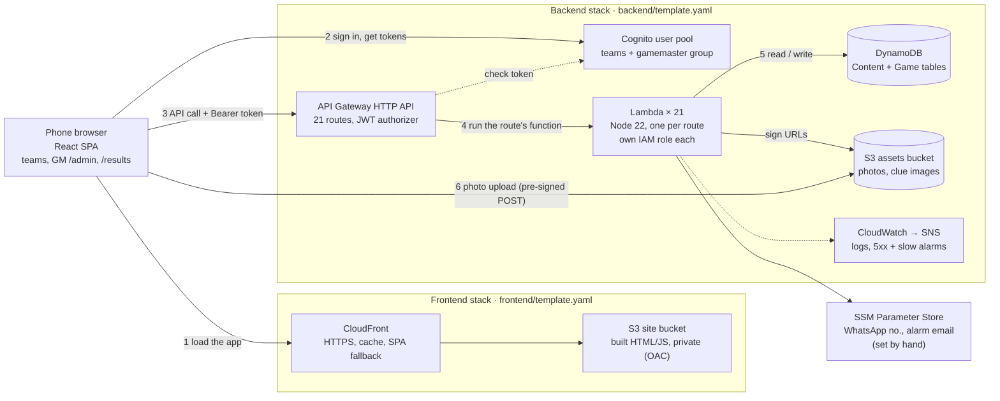

# Serverless Overview (learning guide)

A guided tour of how the Hitchin Treasure Hunt runs on AWS: the services, how a request flows through them, the patterns behind them, and the alternatives we didn't choose. For the detailed design see `03-architecture.md`, `04-data-model.md` and `06-auth-and-security.md`; for deploying see `08-infra-and-deployment.md`.

The app is fully serverless: there are no servers to patch, nothing runs while nobody is playing, and everything except two SSM values is defined in two SAM templates. All resources are in **eu-west-2 (London)**.

## Diagram

The numbers follow one team's journey:

1. Load the app from CloudFront and S3.
2. Sign in with Cognito and get tokens.
3. Call the API with the access token.
4. API Gateway runs the right Lambda.
5. The Lambda reads and writes DynamoDB, and signs S3 URLs.
6. The phone uploads photos straight to S3.

## The services

| Service | Kind | What it does here | Why it was chosen |
|---------|------|-------------------|-------------------|
| **CloudFront + S3 site bucket** | Edge, frontend stack | The React app is built into static files in a private S3 bucket. CloudFront serves them over HTTPS and sends unknown paths like `/admin` back to `index.html` so the app can pick the page. | Static hosting costs pennies and needs no server. Origin Access Control means only CloudFront can read the bucket (ADR-002). |
| **Cognito user pool** | Auth | One login per team plus the game master, who is in the `gamemaster` group. The phone signs in with SRP, so the password never leaves it, and gets access, ID and refresh tokens. | No password storage or token signing code of our own. Self sign-up is off; the register Lambda creates users with `AdminCreateUser` (ADR-004). |
| **API Gateway HTTP API** | Edge, API | The single front door to the backend. Its JWT authorizer checks every token against Cognito before any code runs. It also handles CORS and writes access logs. | Cheaper and faster than a REST API, with the JWT authorizer built in. Only `/health`, `POST /teams` and `/results` skip auth (ADR-005). |
| **Lambda** | Compute | 21 small functions, one per route (reveal, answer, hint, skip, photo, admin decisions…). Each loads the team's state, checks the rule, writes conditionally and returns the new state. | One function per route gives each its own least-privilege IAM role and its own logs. Pre-bundled with esbuild so the shared workspace code is included (ADR-011). |
| **DynamoDB: `Content` + `Game`** | Data | `Content` holds questions and routes, loaded by the seed script. `Game` holds the game status, each team's profile, one item per stage reached and every attempt. A sparse index lists pending GM reviews. | On-demand pricing, no connections to manage from Lambda, and conditional writes and transactions make double taps safe (ADR-003). |
| **S3 assets bucket** | Data, files | Team photos, photo-answer submissions and clue images. Fully private: the phone only sees short-lived pre-signed URLs (upload 5 min, view 15 min). A lifecycle rule expires team photos after 30 days. | Images never pass through Lambda, which keeps functions fast and avoids Lambda's 6 MB payload limit. |
| **SSM Parameter Store** | Config | Values that must stay out of the public repo: the GM's WhatsApp number and the alarm email. Created by hand with the AWS CLI. The Lambdas read the WhatsApp number (cached 5 minutes); the prod stack reads the alarm email at deploy. | Free for standard parameters, and keeps personal data out of git and the templates. |
| **CloudWatch + SNS** | Operations | Every Lambda logs structured JSON (Powertools) to its own log group, kept 14 days. In prod, two alarms (any 5xx, p90 latency over 3 s) email you through an SNS topic. | The alarms watch the API rather than Lambda because the handler turns errors into 500s, so the API's 5xx count catches every failure. |

## Following two requests end to end

### A team answers a question

1. The phone sends `POST /teams/me/current/answer` with `Authorization: Bearer <access token>` and an `attemptId` it generated once.
2. API Gateway's JWT authorizer checks the token's signature, expiry and audience against Cognito. A bad token gets 401 here, without running a Lambda.
3. The answer Lambda reads `teamId` from the token's `sub` claim, never from the request body.
4. It queries the team's items in the `Game` table and the question from `Content` (cached in memory between calls).
5. It checks the answer on the server. If it's correct, one DynamoDB transaction pauses the timer, completes the stage, adds to the team's totals and creates the next clue. All of this is conditional on the stage still being `revealed`.
6. A retry on bad signal hits the same attempt key or fails the condition, so it changes nothing and just returns the current state.

### A team uploads a photo answer

1. The phone resizes the photo to a 1600px JPEG in the browser.
2. `POST /teams/me/current/photo-upload`: a Lambda returns a pre-signed S3 POST for a key it chooses, limited to JPEG, 5 MB and 5 minutes.
3. The phone uploads straight to S3, with no Lambda or API Gateway in the path.
4. `POST /teams/me/current/photo`: a Lambda pauses the timer, sets the stage to `awaiting_review` and adds the attempt to the pending-review index.
5. The GM's `/admin` page polls `GET /admin/reviews` every 5 s and shows the photo through a pre-signed GET URL.
6. Approve or Decline calls an admin route, which only the `gamemaster` group can use. The team's phone polls every 3 s and sees the result.

## Serverless patterns to learn from

| Pattern | The idea | Where it is in this project |
|---------|----------|-----------------------------|
| **Stateless functions, state in the database** | Lambdas keep nothing between calls that matters. Every request rebuilds what it needs from DynamoDB, so any copy of a function can serve any team, and AWS can start or stop copies freely. | Timer = `activeMs` + `runningSince`, stored per stage (ADR-006). The phone's clock is only for display. |
| **Idempotent, conditional writes** | Requests get retried on flaky mobile signal. Every write says "only if the status is still X", so a double tap is harmless instead of scoring twice. | DynamoDB `ConditionExpression` and `TransactWriteItems`. |
| **Let the client talk to S3 directly** | The backend hands out a signed, narrowly scoped permission slip instead of carrying the bytes itself. It's cheaper, faster and avoids Lambda's size limits. | Pre-signed POST for uploads, pre-signed GET for viewing (ADR-005). |
| **Auth at the edge** | The API checks tokens before any code runs, and functions trust only the verified claims. Roles come from Cognito groups. | JWT authorizer, `sub` as `teamId`, and a `cognito:groups` check on `/admin/*`. |
| **Least privilege per function** | Each Lambda's role allows only the tables, bucket prefixes and Cognito actions it uses. A bug in the hint function can't delete users. | SAM policy templates and inline statements in `backend/template.yaml`. |
| **The simplest thing that scales enough** | Short polling instead of WebSockets, a table scan for a five-team leaderboard, and no Step Functions for the review flow. Serverless doesn't mean using every service. | ADR-007 (polling), ADR-009 (review without Step Functions). |
| **Infrastructure as code** | Everything except two SSM values is in two SAM templates, deployed as CloudFormation stacks. Dev and prod are the same templates with different `samconfig.toml` settings. | `npm run deploy -w backend -- dev`, `npm run deploy:stack -w frontend -- dev`. |

## What else could have been used

| Need | Used here | Alternative | Why not, for this app |
|------|-----------|-------------|------------------------|
| Live updates | Short polling | API Gateway WebSockets, AppSync subscriptions | Connection tracking and mobile reconnects aren't worth it for ~20 people. |
| Database | DynamoDB | Aurora Serverless, RDS | Needs a VPC and connection pooling from Lambda, and costs money while idle. |
| GM review workflow | Status field + sparse index | Step Functions with a wait-for-callback | A status flag and a poll do the same job with less to learn and debug. |
| API | HTTP API | REST API, Lambda function URLs | A REST API costs more; function URLs have no shared JWT authorizer. |
| Hosting | S3 + CloudFront | Amplify Hosting | Amplify is easier but hides the pieces this project is meant to teach. |

## How SAM and CloudFormation helped

- **Dev and prod cost little to make.** Prod is the same templates deployed with `--config-env prod`. By hand you'd click through about 50 resources twice and hope they matched.
- **Less wiring by hand.** One function block in SAM gives you the Lambda, its IAM role and its API route. Short policy templates stand in for hand-written IAM policies, and the Cognito authorizer is a few lines.
- **Safe changes.** A deploy only changes what's different, and you can see the change set first; prod waits for your OK. If anything fails, CloudFormation rolls the whole stack back.
- **Outputs feed the next step.** The API URL and user pool IDs come out of the backend stack, and `npm run frontend:env` writes them into the app's config.
- **It's in git.** Every infrastructure change is reviewed and versioned with the code.
- **Easy cleanup.** `sam delete` removes a stack and everything in it, so nothing is left behind costing money.

The trade-off is learning the template syntax. A few things stay manual: the SSM values (so the WhatsApp number stays out of the public repo) and the order of the first deploy, because the backend needs the CloudFront address for CORS.

## Try it yourself in the console

- Open **CloudFormation → `treasurehunt-backend-dev` → Resources** to see every resource SAM created from the template, including the IAM roles nobody wrote by hand.
- In **Lambda**, open any function's **Configuration → Permissions** and compare its role with another function's.
- In **DynamoDB → Explore items** on the dev `Game` table, play one stage on your phone and watch the stage item's `status`, `activeMs` and `runningSince` change.
- In **CloudWatch Logs**, open `/aws/apigateway/treasurehunt-dev` to see each request's route, status and latency.
- Call `GET /teams/me/state` without a token and see the authorizer return 401 before any Lambda runs.
